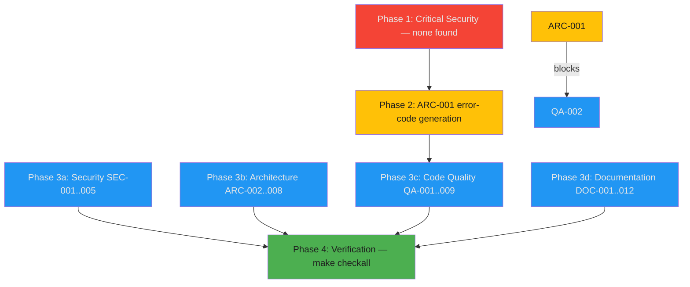

# Project Audit Report

> **Project**: par-rt-db
> **Date**: 2026-11-04
> **Audited revision**: main @ `db94300` (parsight index current at HEAD)
> **Stack**: Rust (axum/tokio/sqlx, Postgres 17), TypeScript (bun, Vite + React dashboard), Python, Swift, Go, Kotlin — ten-package workspace
> **Audited by**: Claude Code Audit System (four parallel domain agents: architecture, security, code quality, documentation)

---

## Executive Summary

The project is in strong health: **zero critical findings across all four domains**. Security posture is deliberate and measured (constant-time comparisons everywhere, systematically parameterized SQL, no information disclosure, no hardcoded secrets); the architecture's load-bearing invariant — a single serialized committer per database — is enforced by the type system rather than prose. The two themes that dominate the findings are (1) **integration debt from the Kotlin SDK's recent landing**: every hub doc, the release runbook, and the CHANGELOG still describe a five-SDK world, and the lockstep version procedure would silently skip the one manifest that carries a bare version field; and (2) **the hand-mirrored protocol's maintenance tax**: seven wire implementations plus five in-memory engines, with the corpus's one known coverage gap (Swift/Go inline error-code lists) still open. The highest-value remediation is cheap: a documentation sweep (S–M effort), error-code list generation from `wire-corpus/error-codes.json` (M), and a dependency bump for RUSTSEC-2026-0387 (S).

### Issue Count by Severity

| Severity | Architecture | Security | Code Quality | Documentation | Total |
|----------|:-----------:|:--------:|:------------:|:-------------:|:-----:|
| 🔴 Critical | 0 | 0 | 0 | 0 | **0** |
| 🟠 High     | 1 | 0 | 3 | 3 | **7** |
| 🟡 Medium   | 3 | 1 | 6 | 3 | **13** |
| 🔵 Low      | 3 | 4 | 0\* | 6 | **13**\* |
| **Total**   | **7** | **5** | **9** | **12** | **33** |

\* Four code-quality low-severity observations were examined and **cleared by the auditor as intentional** (documented `console.debug`, deliberate `should_implement_trait` allows, documented-and-logged broad excepts); they are recorded under Detailed Findings but filed as no board cards. ARC-005 (oversized modules) was found by both the architecture and code-quality agents and is **merged into QA-003** — one card, counted once under Code Quality.

---

## 🔴 Critical Issues (Resolve Immediately)

None found in any domain.

---

## 🟠 High Priority Issues

### [ARC-001] Wire-mirror corpus gap: Swift/Go inline error-code lists are hand-maintained
- **Area**: Architecture (also surfaced by Code Quality as the enforcement side of QA-002)
- **Location**: `server/src/protocol.rs`, `ts-client/src/protocol.ts`, `rust-client/src/wire.rs`, `python-client/src/par_rt_db/wire.py`, `swift-client/Sources/ParRtDbClient/Wire.swift`, `go-client/wire/`, `kotlin-client/src/main/kotlin/dev/parrtdb/wire/`; source of truth `wire-corpus/error-codes.json`
- **Description**: The protocol is mirrored by hand in six client SDKs (a documented no-codegen decision), and the corpus runners are five additional in-memory reimplementations of server semantics — one behavior change can touch up to 12 code surfaces across 6 languages. The corpus plus `golden-vector.json` enforces this, but the Swift and Go clients keep **inline expected error-code lists that corpus cases do not cover**, so an ErrorCode addition passes the corpus while breaking those clients. Historical drift incidents (missing `skip_serializing_if` surfacing as `where:null` corpus drift, admin `extra=forbid` breaking python) confirm the tax is recurring.
- **Impact**: A missed mirror ships a client SDK that breaks against the current server, concentrated exactly where the corpus does not pin. Nothing is published yet (ENH-031 deferred to v1), but every server change pays the mirror cost now.
- **Remedy**: Keep the no-codegen decision, but **generate the enumerated, machine-readable subsets** from `wire-corpus/error-codes.json`: emit the Swift and Go inline expected-code lists (ideally the error-code tables in all six clients) at build time, or add corpus cases exercising every error code end-to-end in each runner so the inline lists cannot silently rot.

### [QA-001] Write-path god function: `execute_txn_with_side` (CC 84)
- **Area**: Code Quality
- **Location**: `server/src/txn/mod.rs:392`
- **Description**: Highest cyclomatic complexity in the repo (CC 84, parsight). One function carries name validation, step counting, SEC-104 aggregate row/step budgets, quiesce admission, advisory locking, statement-timeout setup, idempotency-cache replay, freeze/read-only enforcement, and step execution — 9 parameters behind `#[allow(clippy::too_many_arguments)]`. Inline comments (SEC-104, ENH-018, ENH-048) show each cross-cutting concern accreting here.
- **Impact**: Every new admission/quota/freeze rule edits the single most correctness-critical function; it is the top churn×complexity hotspot. A mistake here stalls the single-writer committer.
- **Remedy**: Extract the pre-execution guards into a `TxnAdmission` check returning an enum (Replay(results) / ReadOnly / Ok), and the combined `set_config` preamble into its own function; move the step loop to `steps.rs` siblings.
- **Sequencing**: The in-flight `codex/rtdb-quiesce-fix` branch adds admission-generation logic inside this exact function — **land that first**.

### [QA-002] Mirrored engines suppress complexity instead of decomposing it
- **Area**: Code Quality
- **Location**: `swift-client/Sources/ParRtDbClient/InMemoryQuery.swift:46,177,327,761` (plus InMemoryMigrate/InMemoryValidate/InMemoryEngine — 55+ suppression sites), and the mirrored CC 39–65 functions: `eval_value_expr` CC 53 (`server/src/value_expr.rs:162`, `rust-client/src/in_memory/value_expr.rs:22`), `executeSearchTerminal` CC 47–59 (ts `query.ts:980`, go `search.go:262`), `parseTableDef` CC 65 (go `schema.go:183`), `_execute_step` CC 49 (python `writes.py:177`)
- **Description**: The same algorithms are hand-mirrored across up to seven implementations and each copy is individually complex. Swift handles this with 18 `swiftlint:disable cyclomatic_complexity function_body_length` regions, one spanning 200+ lines. Suppressed lint stops catching genuinely new complexity; the corpus catches behavioral drift but not structural rot.
- **Impact**: One behavior change edits five-to-seven CC-50+ functions by hand in five languages.
- **Remedy**: Where an interpreter pattern fits (value-expr evaluation, search terminal), decompose per operator **in the server implementation first**, then mirror the same decomposition shape in each client so copies stay structurally comparable. At minimum, track the suppression count per mirror as a ratchet that may not grow.
- **Sequencing**: After ARC-001 (same mirror files) and after the in-flight wire/DSL branches (`enh-031-publish-pipeline`, codex branches) land.

### [QA-003] God files across server and clients *(merges ARC-005)*
- **Area**: Code Quality + Architecture
- **Location**: `rust-client/src/ws.rs` (3,422 lines), `python-client/src/par_rt_db/admin.py` (3,195), `rust-client/src/http.rs` (3,113), `ts-client/src/in_memory/store.ts` (3,101), `rust-client/src/in_memory/query.rs` (2,793), `swift-client/Sources/ParRtDbClient/InMemoryEngine.swift` (2,673), `server/src/subs.rs` (2,628), `server/src/migrate.rs` (2,491, ~800 inline tests), `server/src/presence.rs` (1,804), `server/src/metrics.rs` (1,792), `ts-client/src/admin.ts` (1,836), `ts-client/src/client.ts` (1,786)
- **Description**: The committer itself was properly decomposed; `subs.rs` (the most correctness-critical read-side code), `migrate.rs`, and the client monoliths were not. `InMemoryRtDbClient` in store.ts spans ~1,770 lines and 23 methods mixing schema validation, default/computed-field stamping, TTL, presence rooms, offline queueing, and mutation execution. `subs.rs` is large but internally cohesive, so the concern is milder there.
- **Impact**: These are the highest-churn, highest-risk surfaces; large single files raise review cost and merge contention exactly where a subtle change is a silent-wrong-push defect.
- **Remedy**: Apply the committer treatment: split `subs.rs` along existing seams (read-set classification, skip evaluation, fan-out execution, verification sampler), `migrate.rs` by directive family, and store.ts along its helper seams (move offline-queue and presence into their own modules).

### [DOC-001] Kotlin client (the sixth SDK) is missing from every cross-reference hub doc
- **Area**: Documentation
- **Location**: `docs/clients.md` (both tables + capability matrix — no Kotlin row/column, still says "five client SDKs" / "Six implementations"), `docs/README.md` ("nine packages", per-package README list omits kotlin-client), `CONTRIBUTING.md` (layout table, gate scope, Versioning, PR checklist — lines 26, 40–42, 84–86, 301–302, 446), `server/README.md` intro ("Five client SDKs"), `README.md` Clients section (line 1925)
- **Description**: `kotlin-client/` is a shipped SDK acknowledged by CLAUDE.md, FEATURE_MATRIX.md, wire-corpus/README.md ("seven runners"), and the root README Packages table — but every hub doc still describes a five-SDK world.
- **Impact**: A new consumer reading the clients hub never discovers the JVM/Android SDK. Contributors following the PR checklist's "all five client SDKs" rule will skip the sixth mirror, breaking the wire-parity invariant the repo calls load-bearing. Directly violates the repo's own "Keep docs in sync" invariant.
- **Remedy**: One sweep adding kotlin-client to: docs/clients.md (both tables, capability column, "seven implementations", "all seven runners"), docs/README.md (ten packages, per-package list), CONTRIBUTING.md (layout, gate scope, Versioning, PR checklist), README.md Clients section, server/README.md intro.

### [DOC-002] RELEASING.md lockstep procedure omits the one manifest that would silently miss its bump
- **Area**: Documentation
- **Location**: `docs/RELEASING.md` step 1; echoed in CONTRIBUTING.md "Versioning"
- **Description**: `kotlin-client/build.gradle.kts` line 7 carries `version = "0.1.0"` — a real version field in the lockstep set — but step 1's bump list covers only the Cargo manifests, ts-client/package.json, dashboard/package.json, and python-client/pyproject.toml. The doc also frames the SDK list as five.
- **Impact**: A release cut exactly per the runbook ships with the Kotlin client a version behind, breaking the "one version for the whole protocol surface" contract the CHANGELOG header asserts. The tag procedure is live (v0.1.0 exists; tag pushes trigger the CI pages job) even though publishing is deferred to v1.
- **Remedy**: Add kotlin-client/build.gradle.kts to step 1's bump list (note any Gradle lockfile step), update the SDK enumeration to six.

### [DOC-003] CONTRIBUTING.md's gate description contradicts the canonical README gate table
- **Area**: Documentation
- **Location**: `CONTRIBUTING.md` line 89 ("Its eight stages"), line 453 ("all five golden-vector suites")
- **Description**: The README's verification-gates table (declared canonical by CONTRIBUTING itself) lists eleven stages; CONTRIBUTING says eight. The corpus checklist says five golden-vector suites while wire-corpus/README.md documents seven runners.
- **Impact**: Contributors calibrate effort and CI expectations against the wrong gate.
- **Remedy**: Reference the README table without a stale count (or fix to eleven), and fix runner counts to seven. Land after any gate-leg change (see ARC-003 soft dependency).

---

## 🟡 Medium Priority Issues

### Architecture

#### [ARC-002] AppState is an ordering-sensitive composition root and 204-in-degree hub
- **Location**: `server/src/lib.rs:286` (`AppState`), `AppState::new` from `lib.rs:305`
- **Description**: parsight ranks AppState as the server's top structural hub (in_degree 204). Decomposed into cohesive sub-structs (good), but the constructor is a long sequence whose comments encode construction-order constraints ("built before the committer so it can be threaded into…"). Ordering is enforceable by nothing but reviewer attention; a reorder compiles and fails at runtime or silently changes behavior. Tests intentionally leak AppState, so test binaries accumulate live listeners unless the Drop guard is used.
- **Remedy**: Extract construction into an explicit builder with named steps (or have `Committers::new` and friends construct their own collaborators from `Config`), so each subsystem owns its build order; at minimum add a debug assertion/unit test that ordering invariants hold.

#### [ARC-003] Cross-package build coupling through a gitignored artifact (`ts-client/dist`)
- **Location**: `Makefile` (build/typecheck pull ts-client-build), `dashboard/package.json` (`@par-rt-db/client: workspace:*`, `prepare: bun run build:sdk`)
- **Description**: The dashboard resolves the SDK from gitignored `ts-client/dist`. The gate compensates, but fresh checkouts/worktrees repeatedly fail at dashboard typecheck with a missing-module error that reads as a code defect (documented in CLAUDE.md; has bitten repeatedly per project memory). The dependency is invisible in the dashboard's own manifest.
- **Remedy**: Commit a built dist (undesirable), publish to a private registry, or make the failure self-explanatory: a preflight check at the top of `make checkall`/`typecheck` that detects missing/stale `ts-client/dist` and prints "run make ts-client-build".

#### [ARC-004] Per-database single-writer throughput ceiling is the hard scalability boundary
- **Location**: `server/src/committer/mod.rs` (the serialized turn), `docs/ARCHITECTURE.md` "Performance characteristics"
- **Description**: All writes to one database serialize through a single committer task: measured 149 commits/s sustained (8 writers) and a 3.4s turn hold on a 5k-row `deleteByQuery` that blocks every other write to that database. Scales across databases (one committer per db; per-db lease under multi-instance), which fits the multi-tenant model — but a single hot database cannot scale writes horizontally. The trade is deliberate and documented (ENH-034 restructured fan-out concurrency, ~27% turn-hold improvement).
- **Remedy**: Document the per-db commit budget as an explicit capacity-planning number in the deploy runbook; keep the turn-hold path instrumented (existing benchmark scenarios + `scripts/bench/compare.ts`) so regressions are caught before deploy, since CI deliberately does not run benchmarks.

### Security

#### [SEC-001] Vulnerable transitive dependency: crypto-bigint 0.5.5 (RUSTSEC-2026-0387)
- **Location**: `Cargo.lock` (crypto-bigint 0.5.5), reached via `rsa = "0.9"` at `server/Cargo.toml:152`
- **Description**: `cargo audit` reports RUSTSEC-2026-0387 (2026-10-23): multiple timing-variability issues in operations intended to be constant-time; fixed in ≥ 0.7.6. The `rsa` crate is used for OAuth client-secret JWT signing in `server/src/auth/apple.rs:438-447` and `server/src/auth/microsoft.rs:797-806` — RSA private-key operations, exactly the path timing side channels target.
- **Exploit scenario**: A remote attacker triggering repeated OAuth client-secret signings and measuring response timing with high precision could in principle accumulate a side channel on the private key. Practically difficult (signing is server-side, once per OAuth flow, not a tight oracle loop) — hence Medium, not High.
- **Remedy**: Bump `rsa` to a release pulling crypto-bigint ≥ 0.7.6 or `cargo update -p crypto-bigint`; re-run `cargo audit`. Verify the rsa 0.9 line's comment about getrandom/sha2 features still holds.

### Code Quality

#### [QA-004] Kotlin `!!` after kind checks in the in-memory engine
- **Location**: `kotlin-client/src/main/kotlin/dev/parrtdb/inmemory/SchemaWire.kt:89-91`, `Filter.kt:67,75,115`, `Search.kt:109,114` (29 total in main sources)
- **Description**: `ty.inner!!` follows a `kind == "optional"` check; a payload where `inner` is null despite the kind crashes with an NPE instead of a decode error.
- **Remedy**: A single `requireInner(ty)` helper returning a decoded error, mirroring how the Rust/TS clients surface this.

#### [QA-005] Long parameter lists on the server write path
- **Location**: `server/src/txn/mod.rs:391`, `txn/steps.rs:215`, `txn/row_ops.rs:503`, `txn/cascade.rs:116`, `scheduler.rs:316,363,907`, `storage.rs:173,292`, `subs.rs:1259`, `presence.rs:335` (~20 `#[allow(clippy::too_many_arguments)]` sites)
- **Description**: Argument-threading (ctx, owner, schema, pool, write_set, budget accumulators) rather than a context struct; `MutatePreamble` already exists as partial remediation. The allows normalize the smell rather than fix it.
- **Remedy**: Group the repeated (ctx, owner, schema, write_set, budget) quintet into one `StepCtx` passed by reference. Sequence after QA-003 (same files: subs.rs, presence.rs).

#### [QA-006] `SchemaDefinition<any>` in public SDK signatures
- **Location**: `ts-client/src/in_memory/store.ts:572,1227`
- **Description**: The only real `any` leak in the TS packages — at a validation boundary, the one place types matter most. (The client.ts timer-handle `any`s are justified Node/browser divergence, documented.)
- **Remedy**: `SchemaDefinition<unknown>` or a bounded generic.

#### [QA-007] Dashboard page hotspot
- **Location**: `dashboard/src/pages/DataBrowserPage.tsx` (739 lines, 32 hooks, parsight churn×complexity top-15)
- **Description**: One component owns mutate/patch/delete/undelete flows, history panel, and formatting helpers.
- **Remedy**: Extract `DocumentHistoryPanel` (already a separate in-file function) and the mutation handlers into hooks.

#### [QA-008] Go DSL panics and ignored errors
- **Location**: `go-client/dsl/mutation.go:176,180` (panic on non-encodable doc); 9 ignored-error sites in non-test sources
- **Description**: Panics encode a programmer-error contract in the builder DSL; a `panic` in a library's non-Must API is hostile to service callers. The ignores are mostly deliberate.
- **Remedy**: Return errors from `InsertIf` (breaking) or confine panics to a `Must*` variant; audit the 9 ignores for ones hiding real failures.

#### [QA-009] Unused public helper in the shared core crate (verified)
- **Location**: `core/src/mutation.rs:457` (`WorkflowStatus::as_wire_str`)
- **Description**: parsight dead-code lane, grep-confirmed: the other two `as_wire_str` impls (lines 329, 502) have callers; this one does not — serde's `rename_all` covers serialization and `FromStr` the reverse. (parsight's other "no caller" rows are false positives: dashboard `signInWithOAuth`/`signOut` are consumed through the SessionValue context; Go admin methods are published SDK surface.)
- **Remedy**: Keep if symmetry is intentional (document it), otherwise remove.

### Documentation

#### [DOC-004] README.md internal package-count and mirror-coverage drift
- **Location**: `README.md` — "all nine packages" (lines 181, 240, 1770, 1773) vs "all ten packages" (line 1723, correct); "mirrored in all five clients" (line 832 lookups, line 866 insertMany/upsertMany), "all five admin clients" (line 414) — contradicted by the Kotlin source (`wire/Query.kt`, `wire/Mutation.kt`, AdminClient per its README)
- **Remedy**: Normalize to ten packages / six clients where the claim is true, or cite FEATURE_MATRIX where per-surface coverage differs.

#### [DOC-005] CHANGELOG.md has no Kotlin-client entry under `[Unreleased]`
- **Location**: `CHANGELOG.md` (zero kotlin hits) while FEATURE_MATRIX documents Kotlin mirrors from 2026-10-29
- **Description**: The repo's own rule ("add an entry under [Unreleased] in the same PR") was not met for the whole SDK.
- **Remedy**: Add a grouped `Added` entry covering the SDK, its corpus coverage, and the Android/OkHttp transport note.

#### [DOC-006] Two verified broken cross-references
- **Location**: (a) `README.md:854` cites `server/src/txn.rs` — file does not exist; code lives in `server/src/txn/`. (b) `docs/OAUTH_SETUP.md:59` links `#bearer-delivery-opt-in`; no heading slugifies to that anchor (17 headings enumerated; parsight confirmed both as `target-not-found` / `anchor-not-found`)
- **Remedy**: Point (a) at `server/src/txn/`; point (b) at the heading that actually carries the bearer-mode detail (or add that heading). Land after QA-001 (txn module layout).

---

## 🔵 Low Priority / Improvements

### Architecture

- **[ARC-006] Hand-maintained 1,208-line OpenAPI surface** — `server/src/openapi.rs`: the spec is written by hand in code and can drift from actual routes; the nearby drift checks validate docs, not spec-to-route match. Remedy: a route/spec consistency test.
- **[ARC-007] Prose-only invariants carry bus-factor risk** — `docs/ARCHITECTURE.md` and CLAUDE.md encode rules ("keep read and write index-value typing aligned") enforced by convention. The critical ones already have structural enforcement; add compile/test-time enforcement for the remaining cheap ones.
- **[ARC-008] Shared-Postgres test contention** — 80 test files in one binary share one Postgres with per-test databases; the known `oauth_test` PoolTimedOut full-suite flake is operational friction. Remedy: per-binary pool ceiling or retry-once-on-pool-timeout. (`server/tests/main.rs`)

### Security

- **[SEC-002] CI actions partially tag-pinned instead of SHA-pinned** — `.github/workflows/ci.yml`: `actions/checkout@v7.0.1`, `Swatinem/rust-cache@v2.9.3`, `oven-sh/setup-bun@v2.2.0` are tag-pinned while `dtolnay/rust-toolchain`, `setup-uv`, `setup-go`, `setup-java` are full-SHA pinned. A retagged upstream action executes attacker code in CI, which builds the server binary. Remedy: pin the remainder to full commit SHAs (version in comment).
- **[SEC-003] CSP `script-src 'unsafe-inline'` on OAuth callback interstitials** — `server/src/auth/provider.rs:962,994`: the page is fully static today (no live injection vector), but `unsafe-inline` removes the backstop if the template ever reflects provider/query data. Remedy: replace with a hash source for the exact inline `window.close()` script.
- **[SEC-004] ParMeshV1 `claim_id` stamp accepts an unbounded string** — `server/src/auth/host_policy.rs` (delivered-transition widening, commit db94300): validated only by `Value::is_string`; no length cap at the capability-policy layer (document-size limits apply downstream). Remedy: enforce a known max length in the 3-field shape check, or document that doc-size quotas are the bound.
- **[SEC-005] python-client runtime deps floor-pinned only** — `python-client/pyproject.toml`: `httpx>=0.28.1`, `websockets>=17.4` without upper bounds (`pydantic` is properly bounded `<3`). Remedy: conservative upper bounds.

### Documentation

- **[DOC-007] Root README Packages table omits `core/`** (and core/ has no README) — the Make-targets section lists ten packages; the table lists nine. Repeat docs/README.md's "internal crate" reasoning or add the row.
- **[DOC-008] Stale count in a code comment** — `server/src/error.rs` module doc says "the contract the three client SDKs mirror"; should be six.
- **[DOC-009] kotlin-client/README.md is thin (66 lines) vs peers (145–748)** — no first-time-consumer install section (Gradle coordinates/snippet), no storage/workflow/change-feed/admin examples; corpus case counts will drift.
- **[DOC-010] dashboard/README.md "Logging in" has a dangling colon** — "Two login methods, both funneled through `authenticate_admin` on the server:" followed by prose, not the promised enumeration.
- **[DOC-011] README Query-shape section is one ~65-line paragraph** — accurate but the least scannable part of the doc; the style guide's structure guidance (tables/lists for option sets) would suit the terminal/clause enumeration.
- **[DOC-012] No coverage badge** — CI and license badges exist; coverage runs as a fast CI leg and uploads artifacts, so a badge is feasible.

---

## Detailed Findings

### Architecture & Design

Scope: full workspace structure via parsight graph analytics (central/bridge symbols, communities, impact), plus reads of entry points, manifests, and configuration. **Critical: 0 | High: 1 | Medium: 4 | Low: 3. Overall: Excellent.**

The load-bearing invariant (single serialized committer per database) is enforced structurally in code, not just prose: the committer split puts `publish_taps` behind `pub(in crate::committer)` and makes `execute_txn` reachable only from `arms/` — "never add a second writer" is a compile error. Findings as listed above (ARC-001 through ARC-008; ARC-005 merged into QA-003). Additional context:

- The wire-corpus concept (executable semantics cases run by all seven implementations plus a golden byte-level vector, with a coverage meta-test) turns "mirror every change in six clients" from aspiration into a failing test.
- Multi-instance coordination without consensus machinery: per-db advisory-lock lease with re-assertion on reconnect, a Postgres forward spool designed around the 8KB `pg_notify` cap, idempotency dedup recorded inside the write transaction, split read/write pools.
- Dependency hygiene: zero runtime deps in ts-client, one in go-client, shared Rust deps declared once at the workspace root.

### Security Assessment

Scope: server auth surface (`auth/`, `admin/`), SQL construction (`query/`, `schema/`, `ddl.rs`), storage and signed URLs, WS/HTTP transports, backup, dashboard SPA, dependency manifests (Cargo.lock via `cargo audit`, dashboard/ts-client package.json, python pyproject), CI workflows, newest commit db94300. Previously-fixed items (SEC-007 Origin allowlist, cookie/admin-gate, blob-delete scoping, signed-only storage, fan-out liveness, logout tombstoning, scoped revocation) treated as fixed. **Critical: 0 | High: 0 | Medium: 1 | Low: 4. Overall posture: Strong.**

Positive evidence worth preserving:
- Constant-time discipline is systematic: admin key compare via `ct_eq` with empty/whitespace fail-closed guards (`server/src/config/mod.rs:520,710,925`), OAuth state via `ct_eq` (`provider.rs:828`), signed URLs and webhooks via `ring::hmac::verify`.
- SQL injection defense sound: every interpolated identifier gated by `is_valid_identifier` (ASCII alpha-first, `[A-Za-z0-9_]`, length-capped — `schema/validate.rs:24`) or double-quoted; all values `$n`-bound. The one single-quoted jsonb interpolation (`query/row_auth.rs:66-82`) is reachable only through schema validation. `regconfig` literals pattern-checked and existence-checked.
- No information disclosure: `From<sqlx::Error>` logs server-side, returns generic body (`error.rs:157-176`).
- Tokens: 32-byte OS-CSPRNG, SHA-256 hashed at rest. No weak hashes, no TLS bypasses, no hardcoded secrets. No `unsafe` outside `#[cfg(test)]`; dashboard has no `dangerouslySetInnerHTML`/`eval` and stores no credentials in localStorage.
- WS origin allowlist at upgrade (`ws.rs:77`); `authorize` re-run per Subscribe/Mutate; per-IP admin login rate limiting; CORS via hot-config allowlist; backup credentials via `PG*` env, never argv.

### Code Quality

Scope: ~373K lines across ten packages; parsight analytics (dead code, complexity, hotspots) plus targeted greps and reads. **Critical: 0 | High: 3 | Medium: 6 | Low: 4 cleared observations. Overall: Good.**

Cleared low-severity observations (intentional, no cards filed):
- `console.debug` ×4 in dashboard (`session.tsx:149`, `admin.tsx:103`, `schema-history.tsx:149`) — intentional, commented, DevTools-level.
- `#[allow(clippy::should_implement_trait)]` ×4 in `core/src/wire.rs` — deliberate `from_str`-style naming.
- Python broad `except Exception` ×3 in `ws_client.py:355,385,1372` — documented reconnect semantics, logged with `logger.exception`. Exemplary handling.
- Zero TODO/FIXME/HACK in project source (20 hits are vendored swift-docc artifacts under `swift-client/.build/`).

Test coverage: ~354 test files (76 server integration files in one binary, 44 ts, 101 python, 38 swift, 52 go, 19 kotlin, 24 dashboard); behavior coverage good (>70%), corpus-exhaustive on the wire protocol and in-memory engines; assertion density healthy (167 asserts across 103 tests in `query_test.rs`) plus a 2,205-line proptest parity suite. Lint discipline measured: 2 benign unwrap/expect hits in 200K+ lines of production Rust.

### Documentation Review

Scope: all hub docs read against the repo's own `docs/DOCUMENTATION_STYLE_GUIDE.md`; claims spot-checked against code (quickstart shapes vs admin handlers, 13/13 error codes vs `error.rs`, `PROTOCOL_VERSION = 3` vs README WS example, env-var claims vs `.env.example`/compose); parsight broken-link scan. **Critical: 0 | High: 3 | Medium: 4→3 merged | Low: 6. Overall: Good** — excellent accuracy machinery, dragged down by one un-swept SDK across the hub docs.

Accuracy machinery worth preserving: OpenAPI document has a build-failing drift test, `cli-docs-check` regenerates the CLI reference, `docs-api` denies doc warnings, `env-drift-check` pins `.env.example` against the compose allowlist. `deploy/README.md` is a genuine runbook (symptoms, remediation, rollback, rollout constraints). `wire-corpus/README.md` and `FEATURE_MATRIX.md` are fully current.

---

## Remediation Roadmap

### Immediate Actions (Before Next Deployment)
1. **SEC-001**: bump crypto-bigint past RUSTSEC-2026-0387 (`cargo update -p crypto-bigint` or rsa bump) — S effort, timing-side-channel class in the OAuth signing path.
2. Nothing else is deployment-blocking; zero critical findings.

### Short-term (Next 1–2 Sprints)
1. **DOC-001/002/003/005**: the Kotlin documentation sweep — one remediation arc (hub docs + release runbook + gate counts + CHANGELOG entry).
2. **ARC-001**: generate Swift/Go (ideally all six) error-code tables from `wire-corpus/error-codes.json` — the pre-publish prerequisite.
3. **SEC-002–005**: CI SHA pinning, CSP hash, claim_id cap decision, python dep bounds — all S.
4. **QA-004**: Kotlin `requireInner` helper replacing 29 `!!` sites.
5. **ARC-003 / ARC-004**: dist preflight error message; capacity-planning number in the deploy runbook.

### Long-term (Backlog)
1. **QA-001** (after `codex/rtdb-quiesce-fix` lands): `TxnAdmission` extraction from `execute_txn_with_side`.
2. **QA-002** (after ARC-001 + in-flight wire/DSL branches): interpreter-pattern decomposition, server first, then mirrors; suppression-count ratchet.
3. **QA-003/ARC-005** then **QA-005**: split the god files along existing seams; then the `StepCtx` parameter grouping.
4. **ARC-002**: AppState builder with per-subsystem build order.
5. Remaining: QA-006–009, ARC-006–008, DOC-004, DOC-006–012.

---

## Positive Highlights

1. **Structural enforcement of the core invariant**: "never add a second writer" is a compile error (`pub(in crate::committer)`, `execute_txn` reachable only from `arms/`) — the strongest pattern in the codebase.
2. **The wire-corpus**: seven runners execute every case, a golden byte-level vector pins the wire, and a coverage meta-test fails when a corpus section lacks a consumer.
3. **Constant-time and SQL discipline**: `ct_eq`/`ring::hmac::verify` on every secret comparison; every SQL identifier validated and double-quoted, every value `$n`-bound.
4. **Machine-enforced doc accuracy**: OpenAPI drift test, CLI-reference regeneration gate, doc-warning denial, env-drift check — the docs cannot silently rot the way most repos' do.
5. **Measured lint discipline**: 2 benign unwrap/expect hits in 200K+ lines of production Rust; zero TODO/FIXME in source.
6. **Defense-in-depth subscription invalidation**: three over-approximating skip classes, exhaustive-match guard, shipped 1-in-1000 shadow-verification sampler, missed-push counter treated as a correctness defect.
7. **Multi-instance coordination without consensus machinery**: per-db advisory-lock lease, 8KB-aware forward spool, in-transaction idempotency dedup, split read/write pools.
8. **A genuine operations runbook**: deploy/README.md covers symptoms, remediation, rollback, and rollout constraints, not just happy-path deploys.

---

## Audit Confidence

| Area | Files Reviewed | Confidence |
|------|---------------|-----------|
| Architecture | ~40 (parsight graph over 986 files + targeted reads) | High |
| Security | ~45 (auth/admin/query/storage/transport + manifests + cargo audit) | High |
| Code Quality | ~90 (analytics over full tree + targeted reads incl. tests) | High |
| Documentation | ~30 docs + code spot-checks + parsight link graph | High |

---

## Remediation Plan

> This section is generated by the audit and consumed directly by `/fix-audit`.
> It pre-computes phase assignments and file conflicts so the fix orchestrator
> can proceed without re-analyzing the codebase.

### Phase Assignments

#### Phase 1 — Critical Security (Sequential, Blocking)

No critical security issues found. Phase 1 is empty; proceed directly to Phase 2.

#### Phase 2 — Critical Architecture (Sequential, Blocking)

ARC-001 is High (not Critical) but is **promoted here** because it explicitly blocks QA-002 through shared mirror files — running it sequentially keeps that conflict out of parallel execution.

| ID | Title | File(s) | Severity | Blocks |
|----|-------|---------|----------|--------|
| ARC-001 | Generate swift/go (ideally all six) error-code tables from wire-corpus/error-codes.json | `wire-corpus/error-codes.json`, `swift-client/Sources/ParRtDbClient/Wire.swift`, `go-client/wire/` (+ other mirrors) | High | QA-002 |

#### Phase 3 — Parallel Execution

**3a — Security (all)**

| ID | Title | File(s) | Severity |
|----|-------|---------|----------|
| SEC-001 | Bump crypto-bigint ≥ 0.7.6 (RUSTSEC-2026-0387, rsa/OAuth signing) | `Cargo.lock`, `server/Cargo.toml` | Medium |
| SEC-002 | SHA-pin remaining CI actions | `.github/workflows/ci.yml` | Low |
| SEC-003 | Replace CSP unsafe-inline with script hash on OAuth interstitials | `server/src/auth/provider.rs` | Low |
| SEC-004 | Cap or explicitly bound ParMeshV1 claim_id length | `server/src/auth/host_policy.rs` | Low |
| SEC-005 | Add upper bounds to python-client runtime deps | `python-client/pyproject.toml` | Low |

**3b — Architecture (remaining)**

| ID | Title | File(s) | Severity |
|----|-------|---------|----------|
| ARC-002 | AppState builder / per-subsystem construction order | `server/src/lib.rs` | Medium |
| ARC-003 | ts-client/dist preflight with self-explanatory error | `Makefile`, `dashboard/package.json` | Medium |
| ARC-004 | Document per-db commit budget in deploy runbook | `deploy/README.md`, `docs/ARCHITECTURE.md` | Medium |
| ARC-006 | OpenAPI spec-to-route consistency test | `server/src/openapi.rs` | Low |
| ARC-007 | Cheap enforcement for remaining prose invariants | `docs/ARCHITECTURE.md` + relevant code | Low |
| ARC-008 | Per-binary pool ceiling / retry-on-pool-timeout for tests | `server/tests/main.rs` | Low |

**3c — Code Quality (all)**

| ID | Title | File(s) | Severity |
|----|-------|---------|----------|
| QA-001 | Extract TxnAdmission + set_config preamble from execute_txn_with_side | `server/src/txn/mod.rs` | High |
| QA-002 | Decompose mirrored interpreters server-first; suppression ratchet (after ARC-001) | `server/src/value_expr.rs`, mirror in-memory engines (5 langs) | High |
| QA-003 | Split god files along existing seams (merges ARC-005) | `server/src/subs.rs`, `migrate.rs`, `presence.rs`, `metrics.rs`, `rust-client/src/ws.rs`, `http.rs`, `ts-client/src/in_memory/store.ts`, `admin.ts`, `client.ts`, `python-client/.../admin.py`, `swift-client/.../InMemoryEngine.swift` | High |
| QA-004 | requireInner helper replacing 29 Kotlin `!!` sites | `kotlin-client/.../inmemory/` | Medium |
| QA-005 | StepCtx parameter grouping (after QA-003) | `server/src/txn/`, `scheduler.rs`, `storage.rs`, `subs.rs`, `presence.rs` | Medium |
| QA-006 | SchemaDefinition unknown/bounded generic | `ts-client/src/in_memory/store.ts` | Medium |
| QA-007 | Extract DocumentHistoryPanel + mutation hooks | `dashboard/src/pages/DataBrowserPage.tsx` | Medium |
| QA-008 | Go DSL error returns / Must variant; audit ignored errors | `go-client/dsl/mutation.go` | Medium |
| QA-009 | Remove or document dead WorkflowStatus::as_wire_str | `core/src/mutation.rs` | Medium |

**3d — Documentation (all)**

| ID | Title | File(s) | Severity |
|----|-------|---------|----------|
| DOC-001 | Kotlin sweep across all hub docs incl. clients.md tables/column | `docs/clients.md`, `docs/README.md`, `CONTRIBUTING.md`, `server/README.md`, `README.md` | High |
| DOC-002 | Add kotlin build.gradle.kts to RELEASING lockstep list | `docs/RELEASING.md` | High |
| DOC-003 | Fix gate stage/runner counts (after any gate change) | `CONTRIBUTING.md` | High |
| DOC-004 | Normalize README package/client counts | `README.md` | Medium |
| DOC-005 | CHANGELOG Kotlin entry | `CHANGELOG.md` | Medium |
| DOC-006 | Fix txn.rs path ref + OAUTH_SETUP anchor (after QA-001) | `README.md`, `docs/OAUTH_SETUP.md` | Medium |
| DOC-007 | Packages table core/ row | `README.md` | Low |
| DOC-008 | error.rs "three client SDKs" comment | `server/src/error.rs` | Low |
| DOC-009 | Fatten kotlin-client README | `kotlin-client/README.md` | Low |
| DOC-010 | dashboard README dangling colon | `dashboard/README.md` | Low |
| DOC-011 | Break up README Query-shape paragraph | `README.md` | Low |
| DOC-012 | Add coverage badge | `README.md` | Low |

### File Conflict Map

Files touched by issues in multiple domains (or multiple issues within a phase). Fix agents must read current file state before editing — a prior agent may have already changed these.

| File / File group | Domains | Issues | Risk |
|------|---------|--------|------|
| `swift-client/Sources/ParRtDbClient/` (Wire.swift + InMemory*) | Architecture + Code Quality | ARC-001, QA-002 | ⚠️ Read before edit; ARC-001 sequenced first |
| `go-client/wire/` + `go-client/inmemory/` | Architecture + Code Quality | ARC-001, QA-002, QA-008 (dsl/ separate) | ⚠️ Read before edit; ARC-001 sequenced first |
| `server/src/subs.rs`, `server/src/presence.rs` | Code Quality (two issues) | QA-003, QA-005 | ⚠️ QA-005 depends on QA-003 |
| `server/src/txn/mod.rs` | Code Quality (two issues) + Documentation | QA-001, QA-005, DOC-006 | ⚠️ Read before edit |
| `ts-client/src/in_memory/store.ts` | Code Quality (two issues) | QA-003, QA-006 | ⚠️ Read before edit |
| `README.md` | Documentation (five issues) | DOC-001, DOC-004, DOC-006, DOC-007, DOC-011 | ⚠️ Read before edit |
| `CONTRIBUTING.md` | Documentation (two issues) | DOC-001, DOC-003 | ⚠️ Read before edit |
| `Makefile` | Architecture + Documentation (indirect) | ARC-003, DOC-003 (count references) | ⚠️ Read before edit |

### Blocking Relationships

- ARC-001 → QA-002: same mirror files (swift/go wire + in-memory engines); generate error-code lists before decomposition so edits don't collide.
- QA-003 → QA-005: same files (subs.rs, presence.rs); split first, then regroup parameters.
- ARC-003 → DOC-003 (soft): a dist-preflight gate leg changes the canonical stage count DOC-003 references — land DOC-003 after any gate change.
- QA-001 → DOC-006 (soft): the txn.rs path reference should point at the post-refactor module layout.
- External (in-flight work, not audit issues): QA-001 waits for `codex/rtdb-quiesce-fix` to land (that branch adds admission logic inside `execute_txn_with_side`); QA-002 waits for `enh-031-publish-pipeline` and the codex wire/DSL branches to land.

### Dependency Diagram

