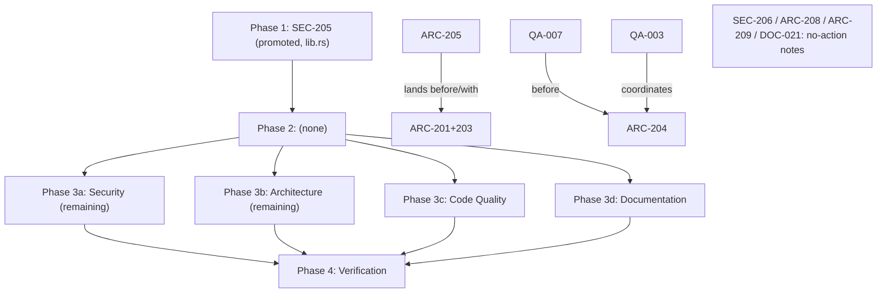

# Project Audit Report

> **Project**: par-rt-db
> **Date**: 2026-11-13
> **Stack**: Rust (axum/tokio + Postgres 17 server, rust-client), TypeScript (ts-client, dashboard), Python, Go, Swift, Kotlin clients
> **Audited by**: Claude Code Audit System (Fable 5 deep audit, `/fable-audit`)

---

## Executive Summary

par-rt-db is in strong health: the single-writer committer invariant is enforced structurally (visibility-restricted taps, wildcard-free write-arm matching), zero TODO/FIXME markers exist across 915 tracked files, and the wire corpus pins seven hand-maintained client implementations to one vocabulary. The most critical finding is a High security gap where an expired admin OAuth session retains instance-wide WebSocket bypass on already-open connections — the per-op re-authorization seam checks revocation but not expiry. The heaviest structural theme is concentration: the transaction executor (complexity 69), the highest-churn committer loop, and seven hand-maintained in-memory mirror engines (~24 files above complexity 300) all sit in one blast radius, and the release-facing docs (CHANGELOG, roadmap, docs index) are the one surface with no freshness gate. Estimated effort to remediate the top issues is roughly two to three focused sessions; the documentation sweep is mechanical.

### Issue Count by Severity

| Severity | Architecture | Security | Code Quality | Documentation | Total |
|----------|:-----------:|:--------:|:------------:|:-------------:|:-----:|
| 🔴 Critical | 0 | 0 | 0 | 0 | **0** |
| 🟠 High     | 2 | 1 | 3 | 5 | **11** |
| 🟡 Medium   | 4 | 1 | 7 | 9 | **21** |
| 🔵 Low      | 3 | 4 | 6 | 9 | **22** |
| **Total**   | **9** | **6** | **16** | **23** | **54** |

Merged-dedup note: ARC-202 + QA-002 share one card (client-mirror god files); ARC-204 + QA-006 share one card (server complexity concentration); ARC-201 + ARC-203 share one card (admin config control plane); QA-001 is the already-tracked ARC-002 card (measurement attached, not re-filed); DOC-001 + DOC-012 + DOC-013 share one card (stale source-path sweep).

---

## User-Directed Focus

No user focus areas were passed to this run (`/fable-audit` invoked without arguments).

---

## 🔴 Critical Issues (Resolve Immediately)

None found. The core invariants hold: `execute_txn` is called only from `server/src/committer/arms/`, `publish_taps` is `pub(in crate::committer)`, write-arm enumeration is compile-checked, client-facing 500s are genericized in `error.rs`, and secrets hygiene is clean.

---

## 🟠 High Priority Issues

### [SEC-201] Expired admin session retains WS admin bypass on open connections
- **Area**: Security (CWE-613 / OWASP A07)
- **Location**: `server/src/ws.rs:557-570` (`authorize_op`), `server/src/auth/session.rs:366-382` (`session_still_valid` checks only `revoked_at IS NULL`), contrast `server/src/auth/mod.rs:307-319` (user branch checks revocation AND expiry). Mirror check in `server/src/subs/mod.rs:228,453` (`authorize_host_push` / `fan_out_inner`).
- **Description**: The handshake resolves sessions and deletes expired ones, but the per-op admin branch runs `is_admin` + `session_still_valid` — never comparing `expires_at` to `now_ms()`. A connection authenticated while the admin session was live keeps `PrincipalCtx::admin_bypass()` after the 30-day session TTL passes, indefinitely, until the socket drops or the session is revoked.
- **Impact**: Instance-wide read/write on any database, insertOnly row patch/replace/delete, and per-row-rule exemption from a stale socket — exactly the mid-connection-denial property SEC-004's re-authorization invariant was built to guarantee, missing one control.
- **Remedy**: In `authorize_op`'s admin branch, add the same expiry check the user branch runs (expose `expires_at` from `Principal::User`, reject with `unauthorized("session expired")` when `expires_at < now_ms()`) before granting `admin_bypass()`. Audit the two subs callers for the same branch. Add a test pinning "expired session loses WS admin bypass on the next op."

### [ARC-201] HotConfig has no cross-replica propagation or coherence under RTDB_MULTI_INSTANCE (with [ARC-203] unserialized read-modify-write)
- **Area**: Architecture
- **Location**: `server/src/admin/settings.rs:112-189` (`patch_config`), `server/src/config/hot.rs:298-315` (`save_hot`), `server/src/main.rs` (sole `load_hot` caller, boot only), contrast `server/src/notify.rs:509` (`run_schema_listener` — the invalidation pattern schemas got and config did not).
- **Description**: `PATCH /admin/config` persists the merged row to the shared `rtdb_config` table, then swaps only the patching replica's `ArcSwap`. Admin routes execute locally on every replica; `load_hot` runs only at boot; there is no NOTIFY channel for config. Under multi-instance, rate-limit ceilings, quota caps, CORS origins, and session TTL silently diverge per replica. Separately (ARC-203), the patch path is an unserialized load→apply→save: two concurrent PATCHes last-store-win, and a replica holding a stale in-memory copy re-persists its full stale row, durably reverting another replica's operator change.
- **Impact**: The hard quota defense is only as strong as the stale value on whichever replica holds the lease; operator changes can be silently reverted.
- **Remedy**: Publish a `rtdb_config` NOTIFY on patch and add a config listener on the `run_schema_listener` pattern (reuse the self-dedupe and backoff plumbing in `notify.rs`); serialize config persistence (single-flight `tokio::sync::Mutex` in `Runtime` or optimistic concurrency with revision + 409). Fix together as one card — the single-flight is the natural insertion point for the NOTIFY publication. Minimally, document the multi-replica constraint in ARCHITECTURE.md and CLAUDE.md.

### [ARC-202] Seven hand-maintained in-memory query engines are the repo's twelve largest and most complex files (merged with QA-002)
- **Area**: Architecture + Code Quality
- **Location**: `rust-client/src/in_memory/query.rs` (2798 LOC, complexity 474, fan-in 33 — #1 god object), `rust-client/src/in_memory/mod.rs` (2727), `python-client/src/par_rt_db/in_memory/query.py` (1830, max fn 46), `python-client/src/par_rt_db/in_memory/store.py` (1773), `ts-client/src/in_memory/query.ts` (1768) and `store.ts` (1772), `go-client/inmemory/writes.go` (1357) and `query.go` (1232), `swift-client/Sources/ParRtDbClient/InMemoryEngine.swift` (1813) + `InMemoryQuery.swift`/`InMemoryMigrate.swift` — roughly 24 files with per-file complexity above 300; only 4 of the top 40 are server code.
- **Description**: The no-codegen SDK strategy requires every client to hand-mirror the server's query/aggregate/validation/stamping/pagination semantics, and each in-memory engine doubles as that SDK's test harness. Duplication scan shows the expected families (`validate_value` ×7 at 0.88 similarity, `apply_patch` ×6 at 0.90, `detect_destructive_changes` ×6 at 0.92) — genuine per-language variation, not collapsible copy-paste. The mitigation is genuinely good (wire corpus + ENH-052 spec tables have caught real drift), but the cost compounds with every new terminal, validation rule, or aggregate form, and the repo's highest-complexity functions (51, 48, 46, 46) all live in the mirrors.
- **Impact**: Highest ongoing maintenance tax in the repo; every engine behavior fix is a 5–7 file shotgun edit where correctness matters most.
- **Remedy**: Not collapsible (no-codegen is a deliberate contract). Manage it: (a) extend the ENH-052 spec-table pattern to remaining rule families so a client port becomes table interpretation (see ENH-053 plan); (b) keep the corpus authoring rule strict — every engine change ships a case in the same commit; (c) add coverage-threshold gates on the mirror engine files so drift cannot land silently (see ENH-054 plan); (d) run a decomposition pass on `rust-client/src/in_memory/query.rs` before its next behavior change.

### [QA-003] Committer loop is the top churn × complexity hotspot
- **Area**: Code Quality
- **Location**: `server/src/committer/mod.rs:1491` (`run_committer`, complexity 34, 22 churn events/14d, hotspot score 748), `server/src/committer/arms/purge.rs:79` (`handle_purge`, same 748); `server/src/auth/host_policy.rs::patch` (513) close behind; four of the top-ten hotspots are the purge pipeline.
- **Description**: The single serialized committer — the architectural heart — is also the most edited file area, with lease-demotion logic, queue-drain, and per-arm spans inlined in one 250+ line loop.
- **Impact**: Change risk concentrates on the component whose correctness everything depends on.
- **Remedy**: Extract the lease-verification block (`committer/mod.rs:1524-1569`) into a named helper (`verify_write_lease_and_demote`); self-contained, the loop keeps dispatch only. Must preserve the single-writer invariant, `Committers::submit` routing, and the `publish_taps` arm rule.

### [QA-001] Transaction executor complexity 69 — already tracked as ARC-002 (measurement attached)
- **Area**: Code Quality
- **Location**: `server/src/txn/mod.rs:394` (`execute_txn_with_side`, complexity 69, ~220 lines, still 69 at `eea4aab`).
- **Description**: Body is flat (max nesting ~4); the score is breadth — a 24-arm step-dispatch match plus admission/replay/read-only branching and the idempotency/audit/webhook tail. Highest single-function complexity in the repo, on the write path every request flows through.
- **Remedy**: Already blocked as board card ARC-002. This audit attaches the line-anchored measurement; guidance: extract the guard rails and the tail from the dispatch loop (two seams), no new card.

### [DOC-001] Stale source-path references in server/README, PRODUCT.md, rust-client README (merged with DOC-012, DOC-013)
- **Area**: Documentation
- **Location**: `server/README.md` layout table (~lines 106-130: cites `src/subs.rs`, `src/db.rs`, `src/http_api.rs`, `src/metrics.rs` — all now directories; `src/db.rs`/`src/subs.rs` verified nonexistent); `PRODUCT.md` (cites `server/src/http_api.rs`, `schema.rs`, `txn.rs`, `config.rs`); `rust-client/README.md` (`src/ws.rs` → now `src/ws/`).
- **Description**: The ARC-003 provider split synced its own references but these pre-existing rows were never caught. server/README's table is the layout map CLAUDE.md points contributors at; its intro also mixes `src/` prefixes with a stated `server/src/` base path.
- **Impact**: Contributors and agents land on nonexistent paths on every deep dive.
- **Remedy**: One sweep across the three files: update rows to module directories, reconcile the prefix convention. Exclude the stale doc copies under `.claude/worktrees/` and `.worktrees/` from the sweep.

### [DOC-002] server/README.md contradicts the opt-in trigram-index contract
- **Area**: Documentation
- **Location**: `server/README.md:156-162`.
- **Description**: Claims every search index carries a GIN trigram index with roughly double the storage; the landed contract (root README "Search modes", FEATURE_MATRIX row 30, CHANGELOG Breaking) is opt-in via `trgm: true`. Three authoritative docs state the opposite of this one.
- **Impact**: Operators planning storage believe trigram cost is unconditional.
- **Remedy**: Rewrite the paragraph to the opt-in contract (`trgm: true` gates the GIN; omitted indexes pay nothing; `mode: "trgm"` against a non-declaring index is BAD_REQUEST; pre-flag indexes grandfathered).

### [DOC-003] CHANGELOG.md has no entries for the 2026-11-13 changes and a three-month Unreleased backlog
- **Area**: Documentation
- **Location**: `CHANGELOG.md` (`[Unreleased]` section).
- **Description**: No entry for the per-stage timing gauges + additive slow-query fields (`f130391`), none for the ParMeshV1 delivered→queued redelivery revert (`eea4aab`, wire-visible), none for the provider split. Exactly one dated release exists (0.1.0, 2026-08-18).
- **Impact**: Consumers of the published SDKs have no release notes for wire-visible changes.
- **Remedy**: Add `[Unreleased]` entries for the three changes; schedule a version-bump release per `docs/RELEASING.md` so the backlog cuts.

### [DOC-004] Release-model documentation contradicts the shipped release workflow
- **Area**: Documentation
- **Location**: `README.md` roadmap (~line 2013), `docs/README.md:12`, `docs/clients.md`, `docs/RELEASING.md` (Swift ordering sentence).
- **Description**: Docs describe tag-driven/manual publication; `.github/workflows/release.yml` publishes on a green push to `main` (paths-ignore for docs/CI-meta) and the release job creates the `vX.Y.Z` tag — the tag is an output, not a trigger. RELEASING.md already describes the main-push shape but its Swift exact-version-resolution sentence describes a post-tag check while the workflow resolves before the tag-creating job runs.
- **Impact**: Readers believe publishing is manual; an accidental version-bump push publishes to public registries — a safety expectation gap.
- **Remedy**: Re-point README's roadmap line, docs/README.md, and clients.md to the green-gated main-push pipeline (RELEASING.md shows docs, not workflow, are stale); fix the RELEASING.md Swift ordering sentence. Decision-shaped: if tag-gating is actually the intent, change the workflow instead — confirm before editing.

### [DOC-005] Client-count drift: docs say "four/five/six implementations" where seven exist
- **Area**: Documentation
- **Location**: `rust-client/README.md` ("one of four"), `python-client/README.md` (intro + wire-contract sections omit Kotlin), `docs/transaction-deadlines.md` ("all six"), `docs/transaction-field-guards.md` (SDK table omits Kotlin; `expectFields` verified at `kotlin-client/src/main/kotlin/dev/parrtdb/dsl/Mutation.kt:35`), `docs/atomic-counter.md`, `PRODUCT.md` ("Four client implementations").
- **Description**: The Kotlin client shipped and the corpus runs seven implementations; older per-feature docs carry the count from when their feature landed. FEATURE_MATRIX and CLAUDE.md already say seven.
- **Impact**: A Kotlin adopter cannot tell whether a feature is mirrored; parity accounting reads as inconsistent — against the repo's own no-drift invariant.
- **Remedy**: One sweep: grep live docs for "four implementations", "five clients", "six clients", "six implementations", "Four client"; update counts and SDK method tables to include Kotlin. Exclude worktree copies.

---

## 🟡 Medium Priority Issues

### [SEC-202] Client-facing 500s stringify serde errors into the Internal envelope
- **Area**: Security (CWE-209 / OWASP A05) — violates the repo's own error invariant (`error.rs:3-4`)
- **Location**: `server/src/migrate/apply.rs:426` and `:545` (`serde_json::to_string(...).map_err(|e| RtDbError::internal(e.to_string()))`), `server/src/committer/arms/migrate.rs:95`, `server/src/admin/dbs.rs:155`. Verify at fix time: `admin/dbs.rs:487,508`, `server/src/workflows.rs:821`, `server/src/scheduler.rs:541,544`, `server/src/http_api/schedule.rs:123`.
- **Description**: The migrate path runs on the client data plane: a serialization failure returns a 500 INTERNAL whose message is a raw serde error string (internal type names, field paths) — schema-internals reconnaissance on a public deployment, and a copy-paste hazard for future edits. `From<sqlx::Error>` in `error.rs:158-176` shows the correct pattern.
- **Remedy**: `tracing::error!` the detail, return `RtDbError::internal("internal error")` (or a specific operator-facing constant), sweep all listed call sites in one pass.

### [ARC-205] No reconciliation for cross-replica subscription invalidation after a listener gap
- **Area**: Architecture
- **Location**: `server/src/notify.rs:461-561` (`run_write_set_listener`).
- **Description**: Undecodable payloads and schema-fetch failures are skipped; a `PgListener` reconnect loses every `rtdb_write_sets` notification published during the gap (LISTEN/NOTIFY has no replay; the forward spool's sweeper reclaims, does not replay). Subscribers on a shadow replica stay stale until the next write that touches them. Multi-instance only.
- **Remedy**: On listener reconnect, trigger a bounded global invalidation (re-fan-out all subscriptions for affected dbs) or sweep `change_head`/seq since the disconnect and re-publish; at minimum add a reconnect counter metric and document the bounded-staleness contract. Should land before or with ARC-201 (both add `notify.rs` listeners; one review pass covers listener lifecycle).

### [ARC-206] `AppState::new` is a ~280-line construction sequence
- **Area**: Architecture
- **Location**: `server/src/lib.rs:337-619`.
- **Description**: Correctness rests on commented move-ordering constraints; now the last unsplit God-construction in the server.
- **Remedy**: Step functions per concern (`build_realtime`, `build_runtime`, `build_limits`) following the provider-split pattern.

### [ARC-204] Server complexity concentration beyond the tracked ARC-002 (merged with QA-006)
- **Area**: Architecture + Code Quality
- **Location**: `server/src/db/bootstrap.rs:111` (`bootstrap_ddl`, 51), `server/src/committer/arms/workflow.rs:16` (`handle_workflow_advance`, 43), `server/src/query/search.rs:184` (`compile_search`, 42), `server/src/webhook.rs:136` (`is_blocked_ip`, 38), `server/src/query/terminals.rs:264` and `:1033` (38/37), churn hotspots `committer/mod.rs` + `arms/purge.rs` (see QA-003), `auth/host_policy.rs::patch`.
- **Description**: Sequential guard/DDL-list style — complexity is breadth, nesting stays shallow. Review load and edit-collision risk, not correctness.
- **Remedy**: Continue the established arms/module-split precedent for the workflow arm and search compiler; `bootstrap_ddl` splits mechanically into per-subsystem functions (after QA-007's shared quoting helper lands); committer loop handled via QA-003.

### [QA-004] Python sync/async admin client duplication
- **Area**: Code Quality
- **Location**: `python-client/src/par_rt_db/admin.py` (2298 lines; ~85 methods ×2 sync/async), `http_client.py` (1048) and `aio_http_client.py` (937); partial `{_admin_ops_db.py, _admin_ops_auth.py}` extraction already exists.
- **Description**: Every admin/HTTP endpoint exists twice in-language; method bodies exist in 4-5 near-identical copies.
- **Remedy**: Finish the `_admin_ops_*` extraction (transport-agnostic op functions, thin sync/async wrappers) — see ENH-055 plan; verification-only alternative acceptable.

### [QA-005] Three exact-duplicate groups (zero false positives)
- **Area**: Code Quality
- **Location**: `python-client/src/par_rt_db/http_client.py:771` + `aio_http_client.py:656` (`transform_url`, byte-identical); `dashboard/src/components/webhooks.tsx:30` + `dashboard/src/pages/WebhooksPage.tsx:231` (`deliveryBadgeClass`); `scripts/bench/lib/{scenarioB,scenarioD,scenarioE}.ts` (`waitAuthenticated` ×3).
- **Remedy**: Hoist each to one shared module (shared HTTP base, exported from `components/webhooks.tsx`, bench lib common file).

### [QA-007] `ensure_table` re-implemented six times in server
- **Area**: Code Quality
- **Location**: `server/src/change_log.rs:55`, `server/src/mutation_log.rs:31`, `server/src/scheduler.rs:264`, `server/src/schema_history.rs:42`, `server/src/storage.rs:42`, plus one more.
- **Description**: Each repeats validate/quote/CREATE-IF-NOT-EXISTS with per-module DDL; quoting discipline correct everywhere, but the SQL-invariant checklist has six enforcement points instead of one.
- **Remedy**: Shared `ensure_module_table(pool, db, qualified_ddl)` helper. Behavior-preserving, no corpus case needed (no wire change). Sequence before ARC-204's `bootstrap_ddl` split so both share the same helper.

### [QA-008] Go-client exported surface flagged unexercised — verify, do not delete
- **Area**: Code Quality (verification task)
- **Location**: `go-client/dsl/cursor.go` (`EncodeCursor`/`DecodeCursor`), `dsl/query.go:63/70`, `dsl/schema.go:102/185`, `errors/errors.go:15` (`HTTPStatus`), ~20 `httpclient`/`inmemory` methods.
- **Description**: No in-repo callers — expected for an SDK, but methods the wire corpus never reaches have unpinned semantics. One parsight candidate verified false positive (`WorkflowStatus::as_wire_str` has a method-reference caller).
- **Remedy**: Grep the corpus runners/tests for each name; add corpus cases for genuinely uncovered exports or document them as intentional surface. Findings file as corpus gaps, not deletions.

### [QA-009] Swift long-lived `Task` captures need a weak-self audit
- **Area**: Code Quality
- **Location**: `swift-client/Sources/ParRtDbClient/WsClient.swift:353` (stored `runLoopTask` captures strong self), `:650-652` (group tasks), `:408` (inner Task recaptures strongly beside a `[weak self]` sibling). 16 `Task {` sites vs 11 `[weak self]` sites.
- **Remedy**: Verify the shutdown path releases `runLoopTask`; prefer `[weak self]` in the stored task and at `:408`.

### [QA-010] Go wsclient silently discards frame-send errors
- **Area**: Code Quality
- **Location**: `go-client/wsclient/feed.go:145/174/230/269`, `presence.go:434`, `subscription.go:133/171`, `client.go:231/398`.
- **Description**: `_ = f.client.sendFrame(...)` on unsubscribe/presence/heartbeat — a dropped unsubscribe desynchronizes server-side feed state until the connection dies.
- **Remedy**: Log the discard at debug level; no protocol change.

### [DOC-006] Go toolchain prerequisite understated
- **Area**: Documentation
- **Location**: `go-client/go.mod` declares `go 1.27`; "Go 1.23+" appears in `README.md` (Packages table + prerequisites), `go-client/README.md:11`, `CONTRIBUTING.md`.
- **Remedy**: Update the three prereq mentions; go.mod stays the single version source.

### [DOC-007] Hot-config count inconsistent
- **Area**: Documentation
- **Location**: `deploy/README.md` "Hot config beats env" says "Eight settings"; `server/src/config/hot.rs` has ten fields (including `per_token_rpm`/`per_db_rpm`); root README says ten.
- **Remedy**: Update deploy/README to ten and list the two rate-limit ceilings.

### [DOC-008] deploy/README.md Monitoring omits the new stage-latency gauges
- **Area**: Documentation
- **Location**: `deploy/README.md` Monitoring section — no mention of `rtdb_auth_stage_us` / `rtdb_rate_limit_stage_us` / `rtdb_schema_stage_us` (added by `f130391` specifically to diagnose stall-type incidents).
- **Remedy**: Add a short paragraph naming the three gauge families and when to alert (e.g. p95 ≥ 1s / p99 ≥ 5s with healthz ok).

### [DOC-009] docs/README.md index omits two contract guides
- **Area**: Documentation
- **Location**: `docs/README.md` — `docs/transaction-deadlines.md` and `docs/transaction-field-guards.md` exist, are linked from the root README, absent from the index.
- **Remedy**: Add entries under "Project guides".

### [DOC-010] kotlin-client README quickstart schema gap
- **Area**: Documentation
- **Location**: `kotlin-client/README.md` — main HTTP example declares only `tasks`, then runs `insertIf("bookings", ...)`; a sequential run fails on the undeclared table.
- **Remedy**: Declare `bookings` in the example schema.

### [DOC-011] CONTRIBUTING.md stale specifics
- **Area**: Documentation
- **Location**: `CONTRIBUTING.md` — "18 files" (now 37 after `c5be668`); un-commented prose inside the "Running tests" shell block breaks copy-paste; prerequisites omit JDK/Gradle and Darwin Swift tooling while root README calls CONTRIBUTING "the full tool list".
- **Remedy**: Fix the count, comment the prose, complete the tool list.

### [DOC-014] go-client README quickstart quality
- **Area**: Documentation
- **Location**: `go-client/README.md` — quickstart ignores the insert error before indexing results, omits schema/token provisioning, no TOC in a 692-line-class document.
- **Remedy**: Check the error, add provisioning steps, add a TOC.

---

## 🔵 Low Priority / Improvements

### [SEC-203] ts-client stores the session token in localStorage in token mode
- **Area**: Security — `ts-client/src/react.tsx:65,236-237,261-262,279`. XSS on the consuming app reads the long-lived token. Remedy: document token mode as XSS-exposed and steer browser apps to cookie mode (HttpOnly, the SEC-001 path the dashboard uses).

### [SEC-204] Stale security-relevant comment on the public serve route
- **Area**: Security — `server/src/http_api/storage.rs:226` says the per-IP public-storage limit is "off by default"; the code default is 300 RPM (`config/limits.rs:80`). Fix the comment.

### [SEC-205] Unauthenticated /metrics exposes build identity
- **Area**: Security — `server/src/lib.rs:858`. Per-db labels are deliberately off the public export (good); residual exposure is `rtdb_build_info` fingerprinting the exact build. Consider admin-scoping or an interior port in the compose deploy.

### [SEC-206] Unique-constraint names surface in 409 bodies — NO ACTION, deliberate
- **Area**: Security — `error.rs:160-167`, documented as deliberate. Keep on the deliberate-disclosure list so a future generic-izing pass doesn't break client error-matching contracts.

### [ARC-207] Corpus reference code sits at the server crate's top level
- `server/src/spec_corpus.rs` (1921 lines), `spec_corpus_pagination.rs`, `spec_corpus_validation.rs` + rows JSON → group into a `spec_corpus/` submodule.

### [QA-011] Dashboard `useAsync` dependency-mirroring biome-ignores (9 sites)
- All carry explanatory comments; a `useAsync`-aware wrapper hook would remove the suppression class. Pages: Audit, Tokens, Storage, ScheduledJobs, Webhooks, Workflows, DocumentHistoryPanel, Subscriptions, Migrate.

### [QA-012] Go wire test functions at complexity 43-45 (cosmetic)
- `go-client/wire/mutation_extra_test.go:253`, `golden_vector_test.go:219` — table-driven restructuring would drop these.

### [QA-013] TS `any` usage — timer handles are the only real ones
- `ts-client/src/client.ts:147/205` (`(handle: any)` timer handles); the `TableDefinition<any, string, any>` sites are type-parameter positions. Type the timer handles.

### [DOC-015..DOC-017, DOC-019, DOC-020, DOC-022, DOC-023] Documentation polish batch
- DOC-015: CHANGELOG claims every client README has a TOC — false for go/kotlin. DOC-016: ts-client README TOC omits two sections. DOC-017: swift-client README says DocC plugin "1.4.3+", root `Package.swift` requires 1.5.0. DOC-019: cli/README overclaims env-var fallback for every flag. DOC-020: python-client examples not copy-paste runnable (literal `...`, undefined `_token()`). DOC-022: FEATURE_MATRIX "last updated 2026-10-22" caption reads as whole-file freshness. DOC-023: ARCHITECTURE.md references `spec/*.json` without the `wire-corpus/` prefix.

### [DOC-018] dashboard README world name vs DESIGN.md direction — decision-shaped
- `dashboard/README.md` says "Instrument Manual"; `DESIGN.md` specifies a "par-mem ops cockpit" direction. Confirm which is authoritative (or whether a redesign card is pending) before editing.

### [ARC-208] parsight dead-code candidates were all false positives — NO ACTION
- `WorkflowStatus::as_wire_str` has a method-reference caller (`server/src/workflows.rs:897`); Go `MarshalJSON` and dashboard TSX entries are interface impls/framework callbacks. Noted so the next audit doesn't re-litigate.

### [ARC-209] Mixed caret/exact pinning in JS manifests — NO ACTION
- Lockfiles pin; the Rust side holds the stricter documented standard. Consistency note only.

### [DOC-021] Frozen-history plan doc names the old Swift manifest path — NO ACTION
- `docs/fable/ENH-031-release-publish-pipeline.md` references `swift-client/Package.swift`; the landed design moved it to the repo root. Frozen history; annotate or leave.

---

## Detailed Findings

### Architecture & Design

Verified via parsight graph analytics (fresh index at main @ `eea4aab`, 30,133 symbols / 1,139 files / ~112K edges) plus direct reads of the committer, lease, notify, config, ws, and admin surfaces, workspace manifests, and the 817-line gate. The single-writer invariant holds end to end: `execute_txn` is called only from `server/src/committer/arms/`, `publish_taps` is `pub(in crate::committer)` (`committer/taps.rs`), and the shadow-vs-owner split is compile-enumerated via wildcard-free matches on `CommitterRequest` in `committer/lease.rs:177-235` — adding a write arm without updating both is a compile error. Overall health: Good, trending Excellent on the server core; residual structural risk concentrates in operational coherence under multi-instance mode and the inherent cost of the six-way mirror strategy. Key concern: the config control plane never got the cross-replica coherence treatment the schema cache received (ARC-201).

parsight's dead-code candidates all verified false positives (ARC-208); churn hotspots cluster on `run_committer`, `handle_purge`, and `auth/host_policy.rs::patch`. See ARC-201 through ARC-209 above for the full issue set.

### Security Assessment

Posture: Strong. Zero critical findings. Secrets hygiene clean (no hardcoded credentials in tracked files, `.env.example` all placeholders with per-knob security rationale, hostname-leak gate present). Crypto correct throughout: 256-bit tokens from the OS CSPRNG (`SysRng`, `util.rs:36-43`), sha256-only token hashing (never passwords), HMAC-SHA256 signed URLs with domain-separated key derivation and constant-time `ring::hmac::verify`, admin key via `subtle::ct_eq`, JWT algorithm derived from key material never the token header, fail-closed JWKS. Auth depth exceptional: per-op WS re-authorization (modulo the SEC-201 expiry gap), live revocation checks, double-gated anonymous access, login-CSRF double-submit binding, SEC-106 admin CSRF, SEC-120 hashed admin sessions, SEC-108 router-layer admin gate, SEC-109 brute-force limits with failure metrics, SEC-201 proxy-header gating, SEC-112 rightmost-XFF keys. SQL construction honors the invariant at every entry. SSRF defense on webhooks exemplary (https-only default, metadata-host denylist, DNS denylist at registration AND connect time closing SEC-114 TOCTOU, redirects refused). Storage serving: inline content-type allowlist, signed-URL transform binding, cross-db 404s avoiding existence oracles, no-enumeration-oracle share grants. The one structural miss is SEC-201; SEC-202 is an invariant-violation sweep; SEC-203..205 are hardening.

### Code Quality

915 tracked source files / ~214K production LOC. Zero `unwrap()`/`expect()` in production Rust (894 raw hits all resolve to test modules on inspection), zero TODO/FIXME/HACK/XXX markers — exceptional. 165 suppression markers total, ~12 in production code, every one carrying a written justification. 236 files >500 lines (~128 production), dominated by the client-mirror engines; largest production file `python-client/src/par_rt_db/admin.py` at 2298. Estimated debt: Low-Moderate — the debt that exists is structural (the 7-way mirror) and known/tracked, not accidental.

Test coverage: ~414 test files (79 server integration files in the single ARC-010 binary, 107 Python, 76 Go, 47 ts-client, 41 dashboard, 38 Swift, 26 Kotlin, plus inline `#[cfg(test)]` modules). Test:production ratios: server 1.22, ts-client 1.27, python-client 1.26, go-client 0.77, rust-client ~0.94, dashboard 0.69. Behavioral-parity tooling unusually deep (spec corpus, semantics corpus, golden vectors, proptest parity, combinations-drift tests in all seven implementations). `merge_test` slowness confirmed environmental. Key untested areas: the go-client exports in QA-008.

The three high-priority items are really one coordinated program: the complexity-69 transaction executor (tracked ARC-002), the highest-churn committer loop (QA-003), and the seven mirror engines (ARC-202) share one blast radius — the write/evaluation path.

### Documentation Review

Overall health: Good. Documentation accuracy is machine-gated (`docs-api` with warnings denied, `cli-docs-check`, `env-drift-check`, OpenAPI two-way drift test), and the three most recent commits show the sync discipline working at commit time. Docstring coverage sampled good across SDKs. The one surface with no freshness gate is the release-facing set — CHANGELOG, roadmap, docs index — which now contradict the shipped main-push auto-publish pipeline and omit the 2026-11-13 changes (DOC-003, DOC-004); everything else that drifts is recoverable by navigation. Doc cross-reference graph: 308 pairs, no material rot in live docs (the only real parsight broken-link hit is the frozen ENH-031 plan doc). `deploy/README.md` is a genuine production runbook (measured load numbers with dates, failure post-mortems, host-reservation protocol, rollback with a pinned downgrade-hazard probe). Grep-hygiene for all doc sweeps: stale copies exist under `.claude/worktrees/fix-audit-remediation/` and `.worktrees/enh-031-publish-pipeline/` — exclude both trees.

---

## Remediation Roadmap

### Immediate Actions (Before Next Deployment)
1. SEC-201 — expired admin session WS bypass (High, security-relevant on the public deployment).
2. DOC-003 — CHANGELOG entries for the wire-visible 2026-11-13 changes.

### Short-term (Next 1–2 Sprints)
1. SEC-202 — genericize the serde-error 500s on the schema-push path.
2. ARC-201 + ARC-203 — admin config cross-replica coherence + single-flight (with ARC-205 listener lifecycle).
3. DOC-001/002/004/005 — the four high doc contradictions (mechanical sweeps + one decision on DOC-004).
4. QA-003 — committer lease-helper extraction.

### Long-term (Backlog)
1. ARC-202 mirror-engine management program (ENH-053/054/055 plans).
2. ARC-204/QA-006 complexity splits, ARC-206 AppState decomposition, ARC-207 corpus submodule.
3. QA-004..QA-010 quality fixes; the DOC medium/low sweeps.

---

## Positive Highlights

1. **The single-writer committer is enforced structurally, not by convention** — arms as modules, visibility-restricted taps, wildcard-free write-arm matching, background tasks enqueuing only through committer request arms.
2. **Zero debt markers** — no TODO/FIXME/HACK/XXX anywhere in 915 tracked files; every suppression carries a written justification.
3. **The wire conformance machinery is best-of-class** — `core/src/envelope.rs` single-sources the vocabulary; the seven-runner corpus + golden vectors + generated spec tables pin behavior across all seven implementations, and the spec tables are generated by running the server's own decision functions.
4. **Crypto and auth depth** — CSPRNG tokens, constant-time comparisons, header-independent JWT algorithm selection, fail-closed JWKS, per-op WS re-authorization, live revocation, and a nine-point named SEC-control chain.
5. **SSRF defense on webhooks** — https-only default, credential rejection, metadata-host denylist, DNS resolution denylist at registration and connect time (TOCTOU closed), redirects refused.
6. **The Makefile is a real engineering artifact** — one gate spanning eight ecosystems, fail-fast ordering, drift checks, a content-addressed gate cache for deploy, pinned audit scanners, CPU-quota-guarded deploy path.
7. **ARCHITECTURE.md is a model internal doc** — invariants with reasoning, measured baselines with honest caveats, rejected alternatives recorded.
8. **deploy/README.md is a genuine production runbook** — measured load numbers with dates, failure post-mortems, a host-reservation protocol, and a rollback section documenting a downgrade hazard with a pinned probe test.

---

## Audit Confidence

| Area | Files Reviewed | Confidence |
|------|---------------|-----------|
| Architecture | ~200 (graph + targeted reads of committer/lease/notify/config/ws/admin) | High |
| Security | Auth, crypto, storage, webhook, admin, error surfaces + manifests | High |
| Code Quality | 915 files via analytics; targeted deep reads of committer, txn, error, backup, ws clients | High |
| Documentation | 28 doc files read in full; link graph swept; samples verified against code | High |

---

## Remediation Plan

> This section is generated by the audit and consumed directly by `/fix-audit`.
> It pre-computes phase assignments and file conflicts so the fix orchestrator
> can proceed without re-analyzing the codebase.
> Per-issue execution detail: `AUDIT-REMEDIATION-PLAN.md` (same ids, same order).

### Phase Assignments

#### Phase 1 — Critical Security (Sequential, Blocking)
<!-- No critical security findings. SEC-205 promoted here: it edits server/src/lib.rs, a conflict file also targeted by ARC-206 (Phase 3b) — keeping the conflict out of parallel execution. -->
| ID | Title | File(s) | Severity |
|----|-------|---------|----------|
| SEC-205 | Unauthenticated /metrics exposes build identity | `server/src/lib.rs` | Low (promoted) |

#### Phase 2 — Critical Architecture (Sequential, Blocking)
| ID | Title | File(s) | Severity | Blocks |
|----|-------|---------|----------|--------|
| (none) | | | | |

#### Phase 3 — Parallel Execution

**3a — Security (remaining)**
| ID | Title | File(s) | Severity |
|----|-------|---------|----------|
| SEC-201 | Expired admin session retains WS admin bypass | `server/src/ws.rs`, `server/src/auth/session.rs`, `server/src/auth/mod.rs`, `server/src/subs/mod.rs` | High |
| SEC-202 | Serde errors stringified into client-facing 500s | `server/src/migrate/apply.rs`, `server/src/committer/arms/migrate.rs`, `server/src/admin/dbs.rs` | Medium |
| SEC-203 | ts-client localStorage token documentation | `ts-client/src/react.tsx` | Low |
| SEC-204 | Stale "off by default" rate-limit comment | `server/src/http_api/storage.rs` | Low |

**3b — Architecture (remaining)**
| ID | Title | File(s) | Severity |
|----|-------|---------|----------|
| ARC-205 | Listener-gap subscription invalidation (lands before/with ARC-201) | `server/src/notify.rs` | Medium |
| ARC-201 | HotConfig cross-replica coherence + single-flight (with ARC-203) | `server/src/admin/settings.rs`, `server/src/config/hot.rs`, `server/src/notify.rs`, `server/src/main.rs` | High |
| ARC-202 | Mirror-engine management program (corpus + coverage gates; ENH-053/054) | client mirror engine files (7 packages) | High |
| ARC-204 | Server complexity splits (workflow arm, search, bootstrap_ddl; with QA-006) | `server/src/committer/arms/workflow.rs`, `server/src/query/search.rs`, `server/src/db/bootstrap.rs`, `server/src/webhook.rs`, `server/src/query/terminals.rs` | Medium |
| ARC-206 | AppState::new decomposition | `server/src/lib.rs` | Medium |
| ARC-207 | spec_corpus/ submodule grouping | `server/src/spec_corpus*.rs` | Low |

**3c — Code Quality (all)**
| ID | Title | File(s) | Severity |
|----|-------|---------|----------|
| QA-003 | Committer lease-verification extraction | `server/src/committer/mod.rs` | High |
| QA-004 | Python admin sync/async extraction (ENH-055) | `python-client/src/par_rt_db/admin.py`, `http_client.py`, `aio_http_client.py` | Medium |
| QA-005 | Three exact-duplicate hoists | `python-client/src/par_rt_db/http_client.py`, `dashboard/src/components/webhooks.tsx`, `scripts/bench/lib/` | Medium |
| QA-007 | Shared ensure_module_table helper | `server/src/change_log.rs`, `mutation_log.rs`, `scheduler.rs`, `schema_history.rs`, `storage.rs` | Medium |
| QA-008 | Go-client corpus-coverage verification (verify-only) | `go-client/` | Medium |
| QA-009 | Swift weak-self audit | `swift-client/Sources/ParRtDbClient/WsClient.swift` | Medium |
| QA-010 | Go wsclient frame-send error logging | `go-client/wsclient/` | Medium |
| QA-011 | useAsync wrapper hook (or accept + document) | `dashboard/src/pages/*` | Low |
| QA-012 | Go wire test table-driven restructuring | `go-client/wire/*_test.go` | Low |
| QA-013 | TS timer-handle typing | `ts-client/src/client.ts` | Low |

**3d — Documentation (all)**
| ID | Title | File(s) | Severity |
|----|-------|---------|----------|
| DOC-001 | Stale source-path sweep (server/README, PRODUCT.md, rust-client README) | `server/README.md`, `PRODUCT.md`, `rust-client/README.md` | High |
| DOC-002 | Trigram opt-in contract fix | `server/README.md` | High |
| DOC-003 | CHANGELOG 2026-11-13 entries + release cut | `CHANGELOG.md` | High |
| DOC-004 | Release-model docs → main-push reality | `README.md`, `docs/README.md`, `docs/clients.md`, `docs/RELEASING.md` | High |
| DOC-005 | Client-count sweep to seven | 6 doc files | High |
| DOC-006 | Go 1.23+ → go 1.27 | `README.md`, `go-client/README.md`, `CONTRIBUTING.md` | Medium |
| DOC-007 | Hot-config count 8 → 10 | `deploy/README.md` | Medium |
| DOC-008 | Monitoring section: stage-latency gauges | `deploy/README.md` | Medium |
| DOC-009 | docs index: add two guides | `docs/README.md` | Medium |
| DOC-010 | Kotlin quickstart schema gap | `kotlin-client/README.md` | Medium |
| DOC-011 | CONTRIBUTING stale specifics | `CONTRIBUTING.md` | Medium |
| DOC-014 | Go quickstart quality | `go-client/README.md` | Medium |
| DOC-015/016/017/019/020/022/023 | Documentation polish batch | various | Low |
| DOC-018 | Dashboard world name (decision-shaped) | `dashboard/README.md` | Low |

### File Conflict Map

| File | Domains | Issues | Risk |
|------|---------|--------|------|
| `server/src/lib.rs` | Security + Architecture | SEC-205, ARC-206 | ⚠️ Read before edit |
| `server/src/committer/mod.rs` | Architecture + Code Quality | ARC-204, QA-003 | ⚠️ Read before edit |
| `server/src/committer/arms/purge.rs` | Architecture + Code Quality | ARC-204, QA-003 | ⚠️ Read before edit |
| `server/src/db/bootstrap.rs` | Architecture + Code Quality | ARC-204, QA-007 | ⚠️ Read before edit |
| `server/src/notify.rs` | Architecture (two issues) | ARC-201, ARC-205 | ⚠️ Sequence: ARC-205 first |
| `server/src/admin/settings.rs` | Architecture (two issues) | ARC-201, ARC-203 | ✅ Same card by design |
| `server/README.md` | Documentation (two issues) | DOC-001, DOC-002 | ⚠️ One agent should take both |
| `go-client/README.md` | Documentation (two issues) | DOC-006, DOC-014 | ⚠️ One agent should take both |
| `docs/transaction-deadlines.md`, `docs/transaction-field-guards.md` | Documentation (two issues) | DOC-005, DOC-009 | ⚠️ One agent should take both |

Intra-domain conflicts within Phase 3d otherwise resolve by assigning both issues sharing a file to one agent.

### Blocking Relationships

- ARC-205 → ARC-201: both add `notify.rs` listeners; land ARC-205's reconnect/lifecycle pass first so one review covers both. (`--depends-on` set on the board.)
- QA-007 → ARC-204: `ensure_module_table` helper must land before the `bootstrap_ddl` split so both share the same quoting helper.
- QA-003 → ARC-204: the committer-loop extraction (QA-003) must precede or be coordinated with ARC-204's `committer/` complexity work — same conflict files.
- QA-001 (== tracked ARC-002) is independent; the complexity-69 measurement is attached to the existing card.
- DOC-018 waits on confirming which dashboard design document is authoritative — decision-shaped, not dependency-shaped.
- DOC-004 decision point: docs describe tag-gating, workflow does main-push — fix docs to match reality unless the intent is tag-gating (confirm before editing).
- All doc sweeps must exclude `.claude/worktrees/` and `.worktrees/` copies.

### Dependency Diagram

